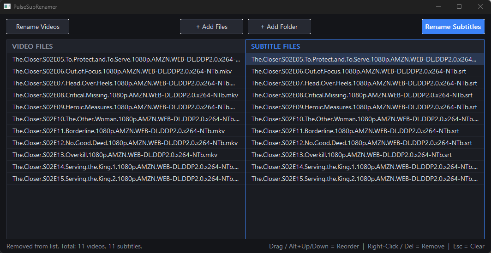

# PulseSubRenamer

A fast, lightweight, zero-dependency native Windows utility (**C++20 / Win32 API**) designed to batch-align and rename video and subtitle files in one click.

## Key Features

* **Truly Portable & Native:** Single standalone executable (`~3.2 MB`) with zero external runtimes or installation required.
* **Modern Dark UI:** File Pilot-inspired dark color palette with native DWM dark title bar, crisp 1px grid lines, and flicker-free double-buffered rendering.
* **Smart Visual Alignment:**
  * Dual-pane synchronized view (`VIDEO FILES` and `SUBTITLE FILES`) with natural sorting (`StrCmpLogicalW`).
  * Displays real filenames in both panes, highlighting files scheduled for renaming in accent blue.
* **Built-in Safety:**
  * Blocks renaming with a clear warning if the number of videos and subtitles does not match.
  * Locks the interface into a read-only **`Exit`** state upon completion to prevent accidental double-renaming.
* **Effortless Reordering & Filtering:**
  * **Drag & Drop** files or folders directly into the window.
  * **Vertical Mouse Drag** or **`Alt + Up / Down`** to manually reorder items within each pane.
  * **Right-Click** context menu (`Remove from list`) or **`Delete`** to remove unmatched items from the list (never deletes files from disk).
  * **`Esc`** to clear both lists instantly.

## Usage

1. Drop a folder or individual video/subtitle files into **PulseSubRenamer** (or click **`+ Add Files`** / **`+ Add Folder`**).
2. If counts differ, remove extra episodes or unmatched subtitle tracks using **Right-Click → Remove from list** or **`Delete`**.
3. Drag rows vertically (or use **`Alt + Up / Down`**) if manual alignment is needed.
4. Click **`Rename Subtitles`** (to match subtitle names to videos) or **`Rename Videos`** (to match video names to subtitles).
5. Click **`Exit`** (or press **`Esc`**) once renaming is complete.

## Building from Source (MinGW-w64 / C++20)

```bat
windres app.rc -O coff -o app.res
g++ -std=c++20 -O2 -municode -mwindows main.cpp app.res -o PulseSubRenamer.exe -lcomdlg32 -lole32 -luuid -lshell32 -lshlwapi -ldwmapi
```

## License

MIT License — see the [LICENSE](LICENSE) file for details.
